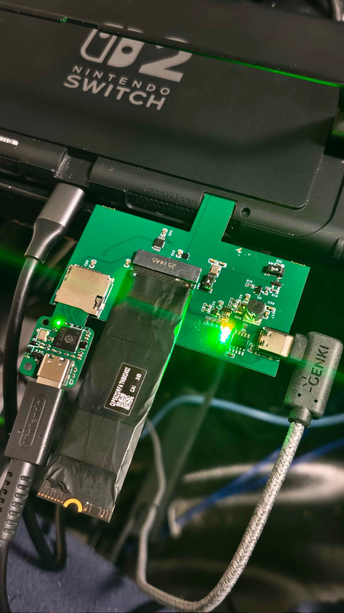

# kagigatainject

**KagigataDisk を「microSD Express カードの SD 側の受け答え役」にするファームウェアです。**
自作の microSD Express → M.2 SSD アダプタと組み合わせると、本物の microSD Express カードがなくても、Nintendo Switch 2 が M.2 SSD を microSD Express カードとして認識します。



*動作デモ: Switch 2 の microSD Express スロットにアダプタを挿し、アダプタの microSD スロットに KagigataDisk、M.2 スロットに SSD を付けた状態。*

> [!WARNING]
> - これは任天堂とは関係のない、非公式の個人プロジェクトです。
> - 本体やカードスロット、SSD、データが壊れる可能性があります。**すべて自己責任**でお使いください。
> - 大切なデータの保存先には使わないでください。

---

## これは何をするもの？

Switch 2 の microSD Express スロットは、挿されたカードにまず **SD カードの手順**で話しかけ、カードが「PCIe も使えます」と答えると **PCIe（SSD と同じ方式）** に切り替えます。

このファームを入れた KagigataDisk は、その **SD 側の会話だけ**を担当し、「PCIe も使えます」と答えます。Switch 2 が PCIe に切り替えると、アダプタが信号線を M.2 SSD につなぎ替え、そこからは SSD が直接 Switch 2 とやり取りします。

```
Switch 2 ──(SD の手順)──▶ KagigataDisk : 「PCIe も使えます」と答える
Switch 2 ──(PCIe)──────▶ M.2 SSD       : アダプタが接続先を切り替えた後
```

## 必要なもの

| もの | 説明 |
|---|---|
| **KagigataDisk** | RP2354A を載せた microSD 型のマイコンボード（[スイッチサイエンス](https://www.switch-science.com/products/11497)）。このファームを書き込みます |
| **microSD Express → M.2 アダプタ** | 自作のもの。Switch 2 が VDD2（1.8V）を入れたら、カードの信号線を KagigataDisk から M.2 SSD に切り替える回路が必要です。KagigataDisk を挿す microSD スロットと、M.2 スロットを持ちます。**このリポジトリには含まれていません** |
| **M.2 NVMe SSD** | **SSD によっては認識されません**（下の「動作確認」を参照） |
| PC と USB-C ケーブル | ファームの書き込みと、ログの確認に使います |

## 動作確認

| SSD | 結果 |
|---|---|
| WD PC SN530 512GB（SDBPNPZ-512G） | ✗ 「SDカードにアクセスできませんでした」 |
| WD PC SN740（デモ写真のもの） | ✓ 正しく認識 |

どちらの SSD でも、KagigataDisk 側のやり取り（PCIe の問い合わせと応答）は同じように成功していました。認識されるかどうかは SSD 側で決まっているようです。

## 書き込み方

### 1. KagigataDisk を書き込みモードにする

KagigataDisk を PC に USB でつなぎます。

- **買ったままの状態（出荷時のファーム）の場合**: USB ドライブとして見えるので、その中の `command/update-firmware` を**削除**します。約 1 秒後に再起動し、`RP2350` という名前のドライブが現れます。
- **すでにこのファームが入っている場合**: 下の「ログの見方」と同じ手順でシリアルコンソールを開き、`bootsel` と入力します。

### 2. ファームをコピーする

[`firmware/kagigatainject.uf2`](firmware/kagigatainject.uf2) を、`RP2350` ドライブにコピーします。コピーが終わると自動で再起動し、このファームが動き始めます。

> 出荷時のファームに戻したいときは、[KagigataDisk の公式リポジトリ](https://github.com/Ar-Ray-code/KagigataDisk)の example/001 を、同じ手順で書き込んでください。

## 使い方

1. アダプタの microSD スロットに KagigataDisk を、M.2 スロットに SSD を取り付けます。
2. アダプタを Switch 2 の microSD Express スロットに挿します。
3. Switch 2 が SSD を microSD Express カードとして認識します。

KagigataDisk の LED の意味:

| LED | 意味 |
|---|---|
| LED1 | 点灯 = 動作中、点滅 = PC と USB でつながっている |
| LED2 | Switch 2 からのコマンドを受けるたびに光る |
| LED3 | 点灯 = Switch 2 の「PCIe は使える？」に「使える」と答えた（ハンドシェイク成功） |

> [!NOTE]
> KagigataDisk に USB-C をつないだままアダプタに挿す場合、アダプタの電源回路によっては電源がぶつかるおそれがあります。お使いのアダプタの回路を確認してください。

## うまくいかないとき

KagigataDisk は、Switch 2 から受け取ったコマンドを記録しています。まずはログを見てください。

### ログの見方

1. KagigataDisk を PC に USB でつなぎます。
2. シリアルターミナル（Tera Term など。ボーレートは何でもかまいません）で、KagigataDisk の COM ポートを開きます。
3. `hist` と入力すると、保存された記録の一覧が出ます。`hist 0` で最新の記録の中身が見られます。

| ログに出ること | 意味と対処 |
|---|---|
| `PCIe ACK` が出ている | KagigataDisk の役目は成功しています。それでも認識されない場合は、**SSD を替える**か、アダプタ（VDD2 での切り替え、SSD の電源）を確認してください |
| `PCIe ACK` が出ていない | `cfg` で設定を確認し、`scr_4bit` が `0`、`cmd_phase` が `0` になっているか見てください。違っていたら `defaults` で初期値に戻せます |
| 記録がない | KagigataDisk に電源が来ていないか、信号線がつながっていません。アダプタを確認してください |

### コンソールのコマンド

| コマンド | 内容 |
|---|---|
| `log` | 今回の起動で受けたコマンド |
| `hist` / `hist N` | 保存された記録の一覧 / N 番目（0 が最新）の中身 |
| `clear` | 保存された記録を消す |
| `cfg` | 設定の一覧 |
| `set 名前 値` | 設定を変える（`reboot` で反映） |
| `defaults` | 設定を初期値に戻す |
| `reboot` / `bootsel` | 再起動 / 書き込みモードへ |
| `selftest run` | 自己診断。**アダプタから抜いた状態でだけ**使ってください |

設定項目の詳しい意味は [技術資料](docs/TECHNICAL.md#設定項目) にあります。初期値は、動作確認できた組み合わせになっています。

## ソースからビルドする

[Raspberry Pi Pico SDK](https://github.com/raspberrypi/pico-sdk)（2.3 系）が必要です。VS Code の Raspberry Pi Pico 拡張機能でこのフォルダを開けば、そのままビルドできます。コマンドラインの場合は次のとおりです。

```bash
cmake -S . -B build -G Ninja
```

```bash
cmake --build build
```

できあがった `build/kagigatainject.uf2` を、上と同じ手順で書き込みます。仕組みや検証の方法は [技術資料](docs/TECHNICAL.md) を見てください。

## ライセンス

[MIT License](LICENSE) です。

`pico_sdk_import.cmake` は Raspberry Pi Pico SDK からのコピーで、ファイル内に記載のとおり BSD 3-Clause License です。

## 謝辞

- [KagigataDisk](https://github.com/Ar-Ray-code/KagigataDisk)（Ar-Ray さん）: ハードウェアと、ボード定義の参考にしたファームウェア
- [Raspberry Pi Pico SDK](https://github.com/raspberrypi/pico-sdk)
